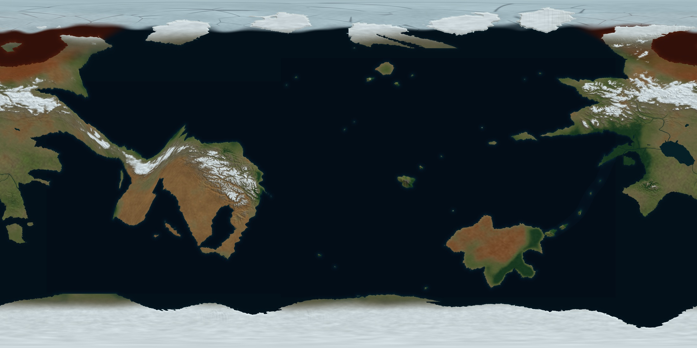

# Catworld Cartography

An editable Blender planet and satellite-style drawing-reference atlas for Catworld / Terra.

Revision 9 follows the creator's latest green correction: the whole mountain connection sweeps south and meets the eastern continent lower on its western flank. The eastern core inclines an additional 13 degrees south. The five-island crossing curves out from Panterra, with larger fragments near the independent southern mainland. An isolated bigger-Hawaii volcanic group, three northern fore-islands and sparse ocean outposts give the far hemisphere more geography.

The primary exports are two clean 8192 × 4096 rectangular world maps: ocean-centered and Panterra-centered. Matching tectonic sheets distinguish proposed collision, subduction, spreading and transform boundaries from drowned shelves and hotspot trails. Numbered versions locate the 39 geographic anchors.

The northern feeder follows the approved redline northwest of the plateau reservoir. The lake drains west through Seattle forest country and separately through the eastern megadam. Broad northern mountain provinces descend into steppe; fertile agricultural lowlands lie south. The seasonal snapshot is northern late autumn / southern late spring, with a working 35-degree tilt and 4,000-Earth-year orbit.

The stable `CATWORLD_Planet/` directory contains the current delivery; Git history preserves earlier iterations.

- Two clean 8K world maps, two tectonic maps and two numbered world maps.
- 16 clean renders and 16 matching annotated plates.
- Editable globe with 13 cameras, four packed textures and 39 named anchors.
- Separate dam and plateau-waterfall models.
- Comprehensive 54-page creator/showrunner PDF, diagrams, daylight table and landmark catalogue.
- Physical terrain fields, directed drainage paths, build scripts and verification records.

After cloning, open `CATWORLD_Planet/OPEN_ATLAS.html` for the offline gallery. Read the [package instructions](CATWORLD_Planet/README.md), [ocean and tectonic notes](CATWORLD_Planet/guide/Ocean_and_Tectonics_R9.md), or [creator guide](CATWORLD_Planet/guide/CATWORLD_Creator_Guide.pdf).

Global relief is exaggerated ten times and river widths are enlarged for drawing clarity. Physical elevation remains 4K; the 8K colour map improves presentation. Local studies use true relief in kilometre units. Plate geometry, the former 65 m lowstand, crossing date and precise seasonal epoch are proposals. The visual model does not solve climate, orbital heating, erosion or hydraulic engineering.

Terrain attribution: [TERRAIN_ATTRIBUTION.md](CATWORLD_Planet/source/TERRAIN_ATTRIBUTION.md). Original pitch deck, private screenshots, backups and temporary work are excluded.
