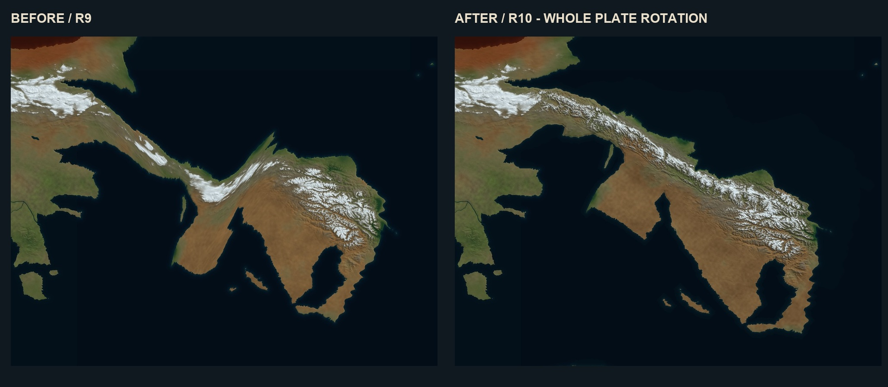
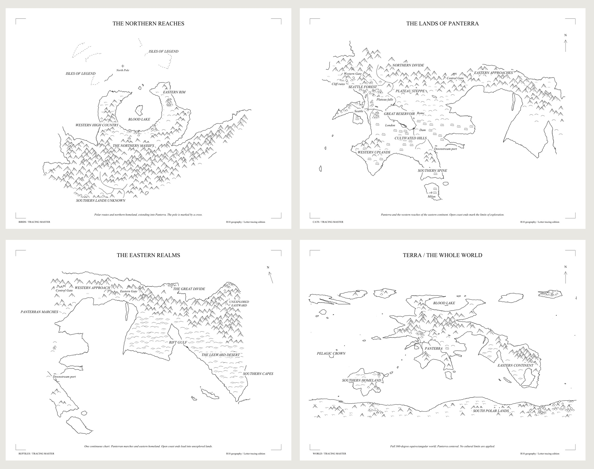

# Catworld Cartography

An editable Blender planet and satellite-style drawing-reference atlas for Catworld / Terra.

Revision 10 replaces the stretched R9 connection. The entire eastern continent uses one rigid 23-degree rotation from the intact R8 baseline. The coast, rift gulf, peninsulas and interior turn together. The junction is reconstructed with a continuous southeast mountain belt, branching relief, high valleys and coastal foothills. Snow and land cover are recalculated at the new elevation and latitude.

The corrected eastern hemisphere and rectangular maps were visually inspected. Geometry checks confirm a connected mountain route, high terrain at every sampled cross-section, preservation of geodesic distances by the rotation and unchanged protected Panterra elevations and southern polar coastline. The detailed method and limits are in [Eastern terrain R10](CATWORLD_Planet/guide/Eastern_Terrain_R10.md).

The primary exports are two clean 8192 × 4096 rectangular world maps: ocean-centered and Panterra-centered. Matching tectonic sheets distinguish proposed collision, subduction, spreading and transform boundaries from drowned shelves and hotspot trails. Numbered versions locate 39 geographic anchors.

The independent southern mainland, curved five-island crossing, Pelagic Crown volcanic group, northern fore-islands and scattered ocean outposts retain their R9 layout. The plateau reservoir drains west through Seattle forest country and separately through the eastern dam. Northern mountains descend into steppe; southern agricultural districts remain fertile rolling country.

The stable `CATWORLD_Planet/` directory contains the current delivery; Git history preserves earlier iterations.

- Two clean 8K world maps, two tectonic maps and two numbered world maps.
- 16 clean renders and 16 matching annotated plates.
- Editable globe with 13 cameras, four packed textures and 39 named anchors.
- Separate dam and plateau-waterfall models.
- Comprehensive 54-page creator/showrunner PDF, diagrams, daylight table and landmark catalogue.
- Physical terrain fields, directed drainage paths, build scripts and verification records.

After cloning, open `CATWORLD_Planet/OPEN_ATLAS.html` for the offline gallery. Read the [package instructions](CATWORLD_Planet/README.md) or [creator guide](CATWORLD_Planet/guide/CATWORLD_Creator_Guide.pdf).

Global relief is exaggerated ten times and river widths are enlarged for drawing clarity. Physical elevation remains 4K; the 8K colour map improves presentation. Local studies use true relief in kilometre units. The model retains a working 35-degree tilt and 4,000-Earth-year orbit. Plate geometry, migration lowstand, crossing date and precise seasonal epoch are proposals; the visual model does not solve climate, orbital heating, erosion or hydraulic engineering.

Terrain attribution: [TERRAIN_ATTRIBUTION.md](CATWORLD_Planet/source/TERRAIN_ATTRIBUTION.md). Original pitch deck, private screenshots, backups and temporary work are excluded.

## Print-and-trace maps

[Catworld tracing pack](CATWORLD_Tracing_Maps/README.txt) adds four black-and-white vector maps on landscape US Letter sheets: birds, cats, reptiles and the complete Panterra-centered world. The R10 planet remains unchanged.

- [Full world on one Letter sheet](CATWORLD_Tracing_Maps/individual/world_trace_Letter.pdf): the complete 2:1 satellite-map projection as economical line art.
- [Four clean tracing sheets](CATWORLD_Tracing_Maps/01_CLEAN_TRACING_LETTER.pdf) or [labelled reference sheets](CATWORLD_Tracing_Maps/02_LABELLED_MAPS_LETTER.pdf).
- [Printing and map guide](CATWORLD_Tracing_Maps/00_READ_FIRST.pdf), editable SVGs, 300-dpi PNGs and an optional 180% tiled version.

Print at 100% / Actual size, landscape, on 8.5 x 11-inch paper. Tracing edition 3 gives the reptiles one continuous view with a gentle 18-degree rotation, about 24% of Panterra, and most of the eastern shore omitted as unexplored. Cats chart about 38% of the eastern continent; birds chart about 23% of Panterra south of the range, with partial legendary-island outlines. These are approximate land-area coverage checks, not political boundaries. Cats do not know the southern homeland.

