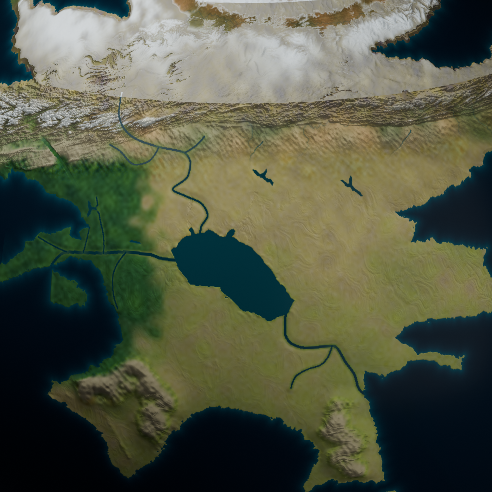

# Catworld Cartography

An editable Blender planet and satellite-style drawing-reference atlas for Catworld / Terra.

Revision 7 follows the creator's latest river redline. The northern feeder winds down the plateau northwest of the reservoir, while the lake drains west through Seattle country and separately through the eastern megadam. The crossed-out eastern feeder is removed. The north is a broad mountain province with steppe foothills; the west is substantial forest country. Two southern mountain groups rise above fertile agricultural lowlands.

The latest pass replaces small circular lakes with branching valley basins, subdues repetitive lowland relief, and makes forest-steppe transitions less rigid. The southern mainland moves a further ten degrees east and one degree south; only five islands remain across the shorter crossing.

The eastern continent rotates eight degrees south. The independent southern mainland has a new asymmetric coast, moves closer to Panterra, and has a shorter, sparse eastern archipelago. Only Panterra and the eastern continent share the mountain connection. Deep ocean separates the eastern and southern continents without a linking island arc.

The current epoch is northern late autumn / southern late spring with 35-degree axial tilt and a 4,000-Earth-year orbit. The guide distinguishes creator direction from proposed heat, climate, ice, migration and engineering details.

The stable `CATWORLD_Planet/` directory contains the current delivery; Git history preserves earlier iterations.

- 16 clean renders and 16 matching annotated plates.
- Editable globe with 13 cameras, four packed textures and 36 geographic anchors.
- Separate dam and plateau-waterfall models.
- Comprehensive creator/showrunner PDF, editable guide, diagrams, daylight table and landmark catalogue.
- Physical terrain fields, directed drainage paths, build scripts and verification records.

After cloning, open `CATWORLD_Planet/OPEN_ATLAS.html` for the offline gallery. Read the [package instructions](CATWORLD_Planet/README.md), [technical companion](CATWORLD_Planet/guide/Geography_and_Design.md), or [creator guide](CATWORLD_Planet/guide/CATWORLD_Creator_Guide.pdf).

Global relief is exaggerated ten times and river widths are enlarged for drawing clarity. Local studies use true relief in kilometre units. The former 65 m lowstand, crossing date and precise 255-degree seasonal epoch are proposals; the heat source and climate are not solved by this visual model.

Terrain attribution: [TERRAIN_ATTRIBUTION.md](CATWORLD_Planet/source/TERRAIN_ATTRIBUTION.md). Original pitch deck, private screenshots, backups and temporary work are excluded.
