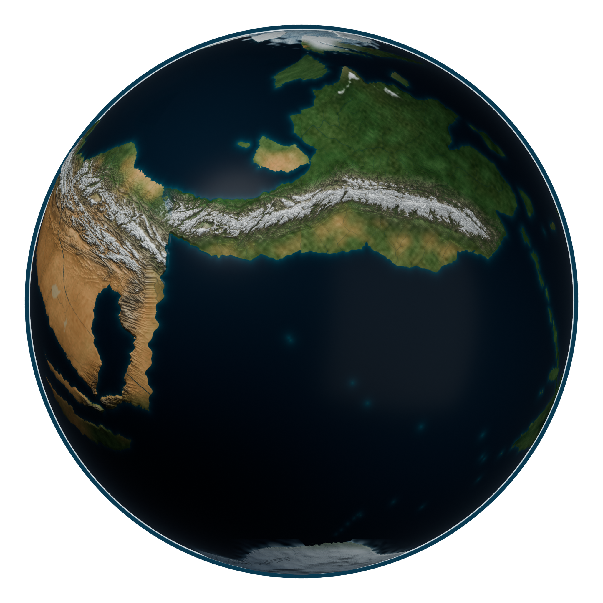

# Catworld Cartography

An editable Blender planet and satellite-style drawing-reference atlas for Catworld / Terra.

Revision 4 shortens the marked mountain bridge by about 58%, rebuilds the maritime continent northward with a substantial interior, removes its long southern tail, and develops the dry core with dune fields and salt basins. Three continental cores remain connected. The waterway runs Seattle -> super-lake -> dam -> downstream city; London and Rome sit near the lake.

The working directory `CATWORLD_Planet/` contains the current iteration. Git history preserves the earlier atlas.

- 14 clean renders and 14 matching annotated plates.
- Editable globe with 12 saved cameras, packed textures and 30 geographic anchors.
- Separate local dam model and two engineering reference views.
- 43-page creator/showrunner guide, explanatory diagrams, tectonic framework and landmark catalogue.
- Terrain source fields, build scripts, verification reports and data attribution.

After cloning or downloading, open `CATWORLD_Planet/OPEN_ATLAS.html` in a browser for the offline gallery. Read the [package instructions](CATWORLD_Planet/README.md), [geographic explanation](CATWORLD_Planet/guide/Geography_and_Design.md), or [illustrated PDF](CATWORLD_Planet/guide/CATWORLD_Creator_Guide.pdf).

The globe uses 10× relief exaggeration for drawing clarity; physical elevations remain in metres. River widths are also exaggerated. Plate history, climate and hydrology are worldbuilding proposals with documented assumptions and limits. The requested 4,000-year orbit is retained.

Terrain-data credit and modification details: [TERRAIN_ATTRIBUTION.md](CATWORLD_Planet/source/TERRAIN_ATTRIBUTION.md). Original pitch-deck files, private message screenshots, backups and temporary work files are excluded.
